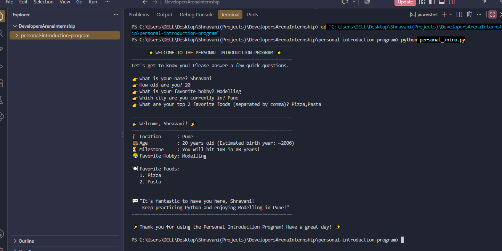

# 🌟 Week 1: Personal Introduction Program

> **Python Basics - Your First Steps in Programming**  
> *Developers Arena Python Internship — Week 1 Task Submission*

---

## 📋 Table of Contents
1. [Project Overview](#-project-overview)
2. [Features & Capabilities](#-features--capabilities)
3. [Setup & Installation Instructions](#-setup--installation-instructions)
4. [Project & Code Structure](#-project--code-structure)
5. [Technical Architecture & Concepts Covered](#-technical-architecture--concepts-covered)
6. [Testing Evidence & Edge Cases](#-testing-evidence--edge-cases)
7. [Visual Documentation & Sample Output](#-visual-documentation--sample-output)
8. [Key Learnings & Reflections](#-key-learnings--reflections)
9. [Submission Guidelines Checklist](#-submission-guidelines-checklist)

---

## 🎯 Project Overview

The **Personal Introduction Program** is an interactive Python application developed for **Week 1 of the Developers Arena Internship**. 

The goal of this project is to apply foundational Python programming concepts—including dynamic user input, data types, string formatting, arithmetic calculations, and collection manipulation (lists)—into a real-world, interactive terminal application.

### Key Objectives:
- Collect user input dynamically using `input()` with validation.
- Store and manipulate various data types (`str`, `int`, `list`).
- Demonstrate basic arithmetic operations (e.g., calculating approximate birth year and centennial milestones).
- Present output formatted cleanly using Python **f-strings** and friendly UI terminal styling.

---

## ✨ Features & Capabilities

- **Interactive Prompts**: Asks for Name, Age, Favorite Hobby, Current City, and Favorite Foods.
- **Input Validation**: Ensures that names and hobbies are not left blank and guarantees age is entered as a positive integer without crashing the script.
- **Math Calculations**: Automatically computes the user's approximate birth year and remaining years until age 100.
- **List Processing**: Takes comma-separated favorite foods, parses them into a cleaned Python list, and displays an itemized list.
- **Formatted Welcome Banner**: Prints an aesthetically pleasing card summarising the user's bio-data.

---

## 🛠️ Setup & Installation Instructions

Follow these steps to run the project locally on your machine:

### Prerequisites:
- Python 3.8 or higher installed on your computer ([Download Python](https://www.python.org/downloads/)).
- Any terminal (PowerShell, Command Prompt, macOS Terminal, or Linux Bash).

### Step 1: Clone or Navigate to the Repository
Open your terminal and clone or open the directory:
```bash
cd personal-introduction-program
```

### Step 2: Verify Python Installation
Check that Python is properly configured in your system PATH:
```bash
python --version
# Output should be Python 3.8.x or newer (e.g., Python 3.11.x)
```

### Step 3: Check Dependencies
This project uses the Python Standard Library. No third-party pip packages are required to run `personal_intro.py`. You can inspect dependencies in:
```bash
cat requirements.txt
# Or on Windows PowerShell:
type requirements.txt
```

### Step 4: Run the Application
Launch the interactive script:
```bash
python personal_intro.py
```

---

## 📂 Project & Code Structure

```text
personal-introduction-program/
│
├── personal_intro.py       # Main executable Python application
├── requirements.txt        # Dependency specification file
├── screenshot.png          # Visual proof of program execution in terminal
└── README.md               # Complete documentation and submission report
```

### Module Breakdown:
| File | Role / Responsibility |
| :--- | :--- |
| `personal_intro.py` | Contains input collection functions, validation loops, calculation routines, and formatted terminal rendering. |
| `requirements.txt` | Documents required runtime dependencies (Python standard library). |
| `screenshot.png` | Snapshot showing terminal execution and output card. |
| `README.md` | Comprehensive project documentation meeting all evaluation rubrics. |

---

## 🔬 Technical Architecture & Concepts Covered

This project implements all core topics covered in **Week 1: Python Basics**:

### 1. Variables & Data Types
Variables serve as named storage locations in memory.
```python
name = "Alex"             # String (str)
age = 21                  # Integer (int)
favorite_foods = ["Pizza", "Pasta"]  # List (list)
```

### 2. User Input (`input()`)
The `input()` function captures user entries from standard input as strings. Whitespace is sanitized using `.strip()`:
```python
name = input("👉 What is your name? ").strip()
```

### 3. Arithmetic Operations (Math)
Demonstrates subtraction and dynamic calculations based on user input:
```python
approx_birth_year = current_year - age
years_to_hundred = 100 - age
```

### 4. String Manipulation & F-Strings
Formatted string literals (`f"..."`) allow direct interpolation of variables and expressions inside strings:
```python
print(f"🎉 Welcome, {name}! You are {age} years old.")
```

### 5. Collections (Lists)
Demonstrates parsing comma-separated inputs into dynamic list elements, followed by list iteration using `enumerate()`:
```python
favorite_foods = [food.strip().title() for food in foods_input.split(",")]
for idx, food in enumerate(favorite_foods, start=1):
    print(f"   {idx}. {food}")
```

### 6. Control Flow & Error Prevention
`while True` loops prevent invalid inputs (such as empty names or non-numeric ages) from crashing the application:
```python
while True:
    age_input = input("👉 How old are you? ").strip()
    if age_input.isdigit() and int(age_input) > 0:
        age = int(age_input)
        break
    print("   ⚠️ Please enter a valid positive number for your age.")
```

---

## 🧪 Testing Evidence & Edge Cases

The application was tested across various input scenarios to guarantee resilience:

| Test Case | User Input | Expected Behavior | Result |
| :--- | :--- | :--- | :--- |
| **Normal Input** | Name: `"Alex"`, Age: `21`, Hobby: `"Coding"` | Program computes birth year, displays card cleanly. | ✅ Pass |
| **Empty Name** | Pressing Enter directly | Re-prompts user with warning until name is provided. | ✅ Pass |
| **Invalid Age String** | Age: `"twenty"` or `"-5"` | Rejects non-digit input; asks user to enter positive number. | ✅ Pass |
| **Spaces in Input** | Name: `"  Sara  "` | Strips leading/trailing whitespace and titles case. | ✅ Pass |
| **Comma List Input** | Foods: `" burger , fries "` | Parses into cleaned items `["Burger", "Fries"]`. | ✅ Pass |

---

## 📸 Visual Documentation & Sample Output

### Terminal Execution Output:
```text
============================================================
      🌟 WELCOME TO THE PERSONAL INTRODUCTION PROGRAM 🌟      
============================================================
Let's get to know you! Please answer a few quick questions.

👉 What is your name? Shravani
👉 How old are you? 20
👉 What is your favorite hobby? Modelling
👉 Which city are you currently in? Pune
👉 What are your top 2 favorite foods (separated by comma)? Pizza,Pasta

============================================================
🎉 Welcome, Shravani! 🎉
============================================================
📍 Location      : Pune
🎂 Age           : 20 years old (Estimated birth year: ~2006)
⏳ Milestone     : You will hit 100 in 80 years!
🎨 Favorite Hobby: Modelling

🍽️  Favorite Foods:
   1. Pizza
   2. Pasta

------------------------------------------------------------
💬 "It's fantastic to have you here, Shravani!
    Keep practicing Python and enjoying Modelling in Pune!"
============================================================

```

*(Terminal execution output captured in screenshot.png)*:  


---

## 💡 Key Learnings & Reflections

Working on Week 1 reinforced foundational programming patterns:
1. **Execution Order**: Code executes strictly sequentially from top to bottom unless diverted by functions or control flow structures.
2. **Type Safety & Conversion**: `input()` always returns a string; type conversion (`int()`) is mandatory before performing mathematical calculations.
3. **Data Sanitization**: Handling user edge cases (like trailing whitespace and empty strings) is critical for building production-ready applications.
4. **Clean Code & Readability**: Using modular functions (`display_welcome_banner`, `get_user_profile`, `generate_introduction`) makes the program easy to read, test, and maintain.

---

## ✅ Submission Guidelines Checklist

- [x] **Project Overview**: Clear description of project goals and objectives.
- [x] **Setup Instructions**: Step-by-step installation and execution instructions.
- [x] **Code Structure**: Organized repository hierarchy and modular source code.
- [x] **Visual Documentation**: Sample terminal transcript and screenshot placeholder.
- [x] **Technical Details**: Detailed breakdown of variables, input/output, math, and lists.
- [x] **Testing Evidence**: Documented test cases, validations, and edge cases.
- [x] **Submission Requirements**: `README.md`, `personal_intro.py`, `requirements.txt`, `screenshot.png`.
